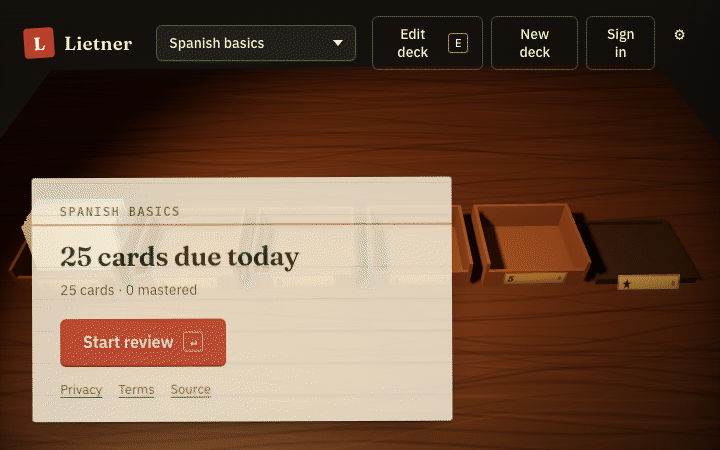
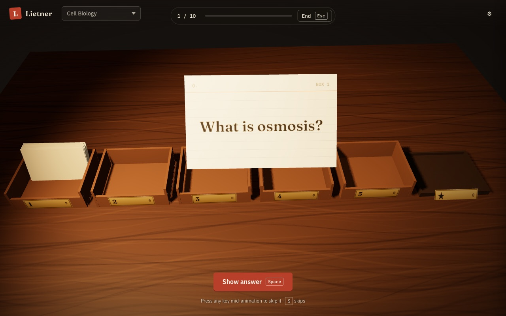
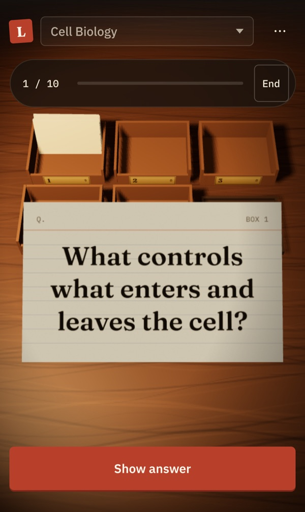
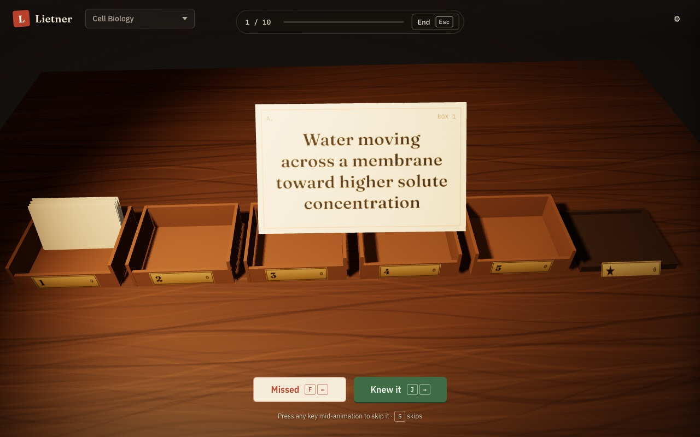
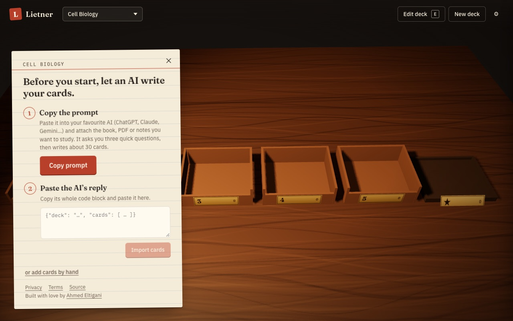

<div align="center">


# Lietner

**Leitner-system flashcards on a 3D desk.**<br>
Free, open source, works offline, no account needed.

[](https://lietner.app)
[](https://github.com/ELTIGA/lietner/actions/workflows/ci.yml)
[](LICENSE)
[](tsconfig.json)
[](#features)
[](CONTRIBUTING.md)

**[Open the app](https://lietner.app)** · [How it works](#how-the-leitner-system-works) · [Features](#features) · [Run it locally](#getting-started) · [Contribute](#contributing) · [Donate](#support-lietner)



</div>

## Screenshots

<table>
  <tr>
    <td width="66%"></td>
    <td width="34%" rowspan="2" align="center"></td>
  </tr>
  <tr>
    <td></td>
  </tr>
  <tr>
    <td></td>
    <td align="center"></td>
  </tr>
  <tr>
    <td align="center"><sub>Desktop: question, answer, and the AI starter sheet</sub></td>
    <td align="center"><sub>Phone: portrait layout, tap to flip, swipe to grade</sub></td>
  </tr>
</table>

## What it is

Five boxes sit on a walnut desk. Each due card lifts out, flips to show the answer, and files itself into the next box, or back into box 1 if you missed it. The same desk works on phones, tablets and desktops. Signing in is optional; it syncs your decks and progress between devices.

## How the Leitner system works

- New cards start in **box 1**. Boxes 1 to 5 come due every **1, 2, 4, 8 and 16 days**.
- You grade yourself. **Knew it** moves a card up one box. **Missed** sends it back to box 1, due tomorrow.
- Knowing a card in box 5 **masters** it (the ★ tray). Each session reviews every card that's due.

Cards you know well come back rarely, and cards you struggle with come back often. That's spaced repetition, with no algorithm to tune.

## Features

- **Any language.** Cards are plain front/back text in any language or script, including right-to-left.
- **Getting cards in.** Keep several decks. Add cards in the editor, import CSV/TSV (including Anki's plain-text export), or copy a prompt into your own AI and paste back the JSON cards it writes.
- **Desktop.** Keyboard shortcuts: `↵` start, `Space` show answer, `J`/`→` knew, `F`/`←` missed, `Z` undo, `S` skip animation, `Esc` end.
- **Touch screens.** Tap to flip, and swipe to grade.
- **Speed.** Normal, Fast and Instant animations.
- **Offline.** An installable app that works fully offline, with a text mode for browsers without WebGL.
- **Your data.** JSON export and import of everything.

## Privacy

- **Guest mode** (no account) keeps everything in your browser's IndexedDB. Nothing about your cards leaves the device.
- **Signing in** syncs your decks and progress to a database in the EU (Supabase, Ireland).
  - Sign in with Google, or with a 6-digit code sent by email. Accounts are for ages 13+.
  - Nothing is shared or public, and grade history never leaves the device.
- **Telemetry** is limited to aggregate, cookieless page-view counts (Vercel Web Analytics) and crash reports with card text removed (Sentry, EU). There are no ads and no data sales.
- **Your data stays yours.** Export everything as JSON, or delete your account from Settings, at any time.

Full details: [Privacy policy](https://lietner.app/privacy) · [Terms](https://lietner.app/terms).

## Tech stack

- **App:** TypeScript (strict) and [Vite](https://vite.dev), with no UI framework. A small `h()` helper builds the DOM.
- **3D:** [three.js](https://threejs.org) for the desk, and [GSAP](https://gsap.com) for card animations.
- **Storage:** IndexedDB via [idb](https://github.com/jakearchibald/idb). It is the source of truth.
- **Sync:** [Supabase](https://supabase.com) (Postgres with row-level security, plus Auth), local-first with last write wins per row.
- **Offline:** a PWA, with Workbox through [vite-plugin-pwa](https://vite-pwa-org.netlify.app).
- **Tooling:** [Biome](https://biomejs.dev) for linting and formatting.
- **Tests:** [Vitest](https://vitest.dev), [Playwright](https://playwright.dev) and pgTAP.

How the pieces fit together: [docs/architecture.md](docs/architecture.md).

## Getting started

Requires Node.js 22.12 or later (`.nvmrc` pins the version CI uses) and npm.

```bash
npm install
npm run dev       # http://localhost:5173, guest mode
```

| Script | What it does |
|---|---|
| `npm run dev` | Dev server with hot reload |
| `npm run build` | Typecheck and build the static site into `dist/` |
| `npm run preview` | Serve the production build locally |
| `npm run lint` | Lint and check formatting (Biome) |
| `npm run format` | Apply formatting and safe lint fixes |
| `npm run typecheck` | Typecheck the app, tests and config files |
| `npm test` | Unit tests: scheduling, imports, storage, backup, sync |
| `npm run test:e2e` | Playwright tests: desktop Chrome, emulated iPhone and iPad, no-WebGL text mode. On the first run, install browsers with `npx playwright install` |
| `npm run test:db` | Row-level security and trigger tests (pgTAP, needs the local Supabase stack) |
| `npm run test:integration` | Sync engine against the local Supabase stack |
| `npm run icons` | Regenerate the favicon and app icons from `public/logo.svg` |

### Sync and sign-in locally

Sync uses [Supabase](https://supabase.com). The Supabase CLI runs a local stack in Docker:

```bash
npx supabase start          # first run downloads the Docker images
npx supabase status         # shows the API URL and publishable key
cp .env.example .env.local  # paste the URL and key, then restart npm run dev
```

- Email codes sent by the local stack appear in the local mail catcher at http://127.0.0.1:54324.
- After editing `supabase/templates/magic_link.html`, run `npx supabase stop && npx supabase start`: the stack mounts the file at start, so it keeps serving the old copy until then.
- Google sign-in needs a real OAuth client ID. It only works on `localhost:5173` and in production.
- Without any `VITE_SUPABASE_*` variables, the app runs guest-only. Preview deploys run this way too.

### Dev helpers

- `?mode=text` forces the text mode that browsers without WebGL get.
- `?today=3` shifts the app clock forward 3 days (dev server only), to test schedules.
- `window.__leitner` exposes the stage, the desk, the card actor and the app in dev.
- Data is tied to the URL origin. `npm run dev` (:5173), `npm run preview` (:4173) and lietner.app each have their own database.
- With `npm run dev` running, `node scripts/capture-assets.mjs http://localhost:5173` recaptures `public/og.jpg` and the demo frames. Then `python3 scripts/frames-to-gif.py` turns the frames into `docs/demo.gif`.

## Project structure

```
src/domain     pure Leitner rules and calendar-day math
src/data       IndexedDB schema, repo, CSV/JSON card import, JSON backup
src/sync       sync engine and scheduler, Supabase remote
src/auth       Supabase session, Google ID-token sign-in
src/scene      three.js stage, desk, boxes, animated card, canvas card faces
src/ui         DOM overlay: app controller, review, editor, dialogs, settings
src/telemetry  analytics and crash reports with card text scrubbed
src/strings.ts every user-visible string
supabase/      SQL migration (tables, row-level security, triggers) and pgTAP tests
e2e/           Playwright specs
scripts/       capture scripts for the demo GIF and Open Graph image
```

## Documentation

- [Architecture](docs/architecture.md): layers, storage, sync design, rendering, testing.
- [Deployment](docs/deployment.md): running your own instance on Vercel and Supabase.
- [Product scope](docs/scope.md): what Lietner does and deliberately doesn't do.
- [Changelog](CHANGELOG.md).

## Contributing

Bug reports and focused pull requests are welcome.

- Read [CONTRIBUTING.md](CONTRIBUTING.md) and the [product scope](docs/scope.md) first.
- Report security issues privately, as described in [SECURITY.md](SECURITY.md).
- This project follows the [Code of Conduct](CODE_OF_CONDUCT.md).

## Support Lietner

Lietner is free and costs nothing to run until it outgrows the free tiers. If it helps you study, consider [donating to keep it running](https://gogetfunding.com/keep-lietner-running/).

## License

[MIT](LICENSE). The animation library [GSAP](https://gsap.com) is used under its own [Standard License](https://gsap.com/standard-license).
