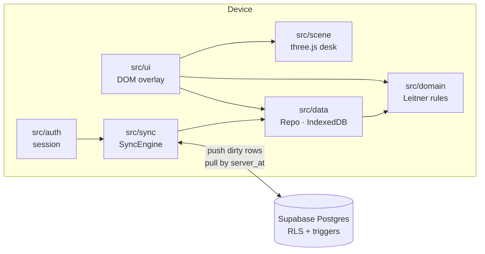

# Architecture

Lietner is a static single-page app: TypeScript and Vite, with no UI framework. A three.js scene draws the desk, and a DOM overlay holds the controls. IndexedDB on the device is the source of truth. An optional Supabase project mirrors each account's decks so they can sync between devices. Apart from SQL migrations, there is no server code.

## Layers

| Folder | Responsibility | Depends on |
|---|---|---|
| `src/domain` | Leitner scheduling and calendar-day math. Pure functions, no I/O. | nothing |
| `src/data` | IndexedDB schema and migrations, the `Repo` used by the UI, CSV/JSON import, JSON backup, sign-out wipe | `domain` |
| `src/sync` | `SyncEngine` (push/pull), `SyncScheduler` (when to sync), the `Remote` interface and its Supabase implementation | `data`, `domain` |
| `src/auth` | Supabase session, email codes, Google ID-token sign-in | `sync` |
| `src/scene` | three.js stage, desk, boxes, the animated card, canvas-drawn card faces | `domain` |
| `src/ui` | App controller, review session, editor, starter sheet, dialogs, settings, account | all of the above |
| `src/telemetry` | Page views and crash reports, with card text scrubbed out | nothing |
| `supabase/` | SQL migration (tables, row-level security, triggers) and pgTAP tests | — |

`src/strings.ts` holds every user-visible string, so the UI can be translated in one place.

## Scheduling (`src/domain`)

- A card sits in box 1 to 5, or in box 6, which means mastered. Landing in box *n* makes the card due again after `INTERVALS[n - 1]` days (1, 2, 4, 8, 16).
- Grading is a pure function. `grade(card, knew, day)` returns a new card with its box, due day and grade history updated.
- Days are integers from `dayNumber()`, which projects the local calendar date onto UTC. Time zones and daylight-saving shifts never move a card by a day.
- `sessionQueue()` orders due cards by box, lowest first, and shuffles them within each box.

## Local storage (`src/data`)

- IndexedDB database `leitner-3d`, schema version 2. It has three stores:
  - `decks`, indexed by `dirty`.
  - `cards`, indexed by `deckId` and `dirty`.
  - `meta`, for sync cursors and per-device settings.
- Every deck and card row carries `updatedAt`, `deletedAt` and `dirty`:
  - Deleting a row leaves a tombstone, so the deletion can sync. Every read skips tombstones.
  - `updatedAt` is monotonic per row, so a local edit always beats the version it was based on.
- The client enforces the limits in `LIMITS` (1,000 characters per side, 5,000 cards, 100 decks). The database enforces the same limits.
- A JSON backup (`leitner-3d-backup`, version 1) holds every deck and card, including grade history. Importing one turns the backup's rows into fresh local edits, so a signed-in account converges on the backup at the next sync.

> **Never rename** the database (`leitner-3d`) or the backup format string. Existing users' decks and old backup files depend on both.

## Rendering (`src/scene`)

- `Stage` owns the renderer, the camera and the layout:
  - **Layout.** It picks a landscape or portrait camera rig by aspect ratio. Portrait screens get the boxes in two rows and a narrower field of view.
  - **Render on demand.** It draws a frame only while something animates or the layout changes.
  - **Quality.** Phones cap the device pixel ratio at 1.5. If frames run slow, quality drops automatically.
- `Desk` builds the walnut desk, the five boxes, the mastered tray and the card stacks.
- `CardActor` animates the card under review with GSAP timelines: draw, flip, file into a box, and follow a swipe. Every animation can be fast-forwarded with `finish()`.
- `textures.ts` draws card faces on a canvas:
  - Text wraps with `Intl.Segmenter`, so Chinese, Japanese and Thai break at word boundaries.
  - Right-to-left text lays out right to left.
- The UI only talks to the scene through the `DeskView` and `CardView` interfaces in `views.ts`. Without WebGL, `src/ui/textDesk.ts` implements the same interfaces in plain DOM (text mode). The review flow is identical in both modes.

## Sync (`src/sync` and `supabase/`)

Sync is local-first. The app works without the network, and the server is a per-account mirror.

**Each run** (`SyncEngine.sync()`):

1. Confirm that the account still exists. If it doesn't, sign this device out.
2. Push rows with `dirty = 1`, decks before cards, in chunks. The server may refuse a row (a limit, for example). That row stays on the device and the rest of the chunk still goes through.
3. Pull every row the server stored since the last cursor. Paging is keyset on `(server_at, id)`, with a 60-second lookback for transactions that commit late.
4. Apply the pulled rows to IndexedDB. Edits made on the device while the push was in flight are kept.

**Server rules** (SQL triggers in `supabase/migrations/`):

- `updated_at` is capped at the server clock, so a device whose clock runs fast can't win every conflict.
- The newer `updated_at` wins, per row.
- Deletions are final. Deleting a deck also tombstones its cards.
- `server_at` is stamped on every write and is what devices pull by. An offline edit pushed days later keeps its old `updated_at`, but it gets a fresh `server_at`, so no device's cursor skips it.
- Row-level security limits every account to its own rows. `delete_account()` removes the caller's auth user, and the foreign keys cascade to their data.

**When it runs** (`SyncScheduler`):

- On start.
- About 2 seconds after the last local change.
- When the window regains focus or the network comes back.

There is no realtime connection and no polling. While the backend is unreachable, the scheduler retries with backoff (30 seconds, doubling up to 5 minutes). The Web Locks API keeps it to one sync at a time across tabs.

**What never syncs:** grade history, animation speed and the last-opened deck. These stay on the device.

## Accounts (`src/auth`, `src/ui/account.ts`)

- The Supabase SDK is loaded with `import()` only when sync is configured and either a session is stored or someone taps Sign in. Guests never download it.
- There are two sign-in methods:
  - **Email.** A 6-digit code (Supabase email OTP).
  - **Google.** The ID-token flow: the hashed nonce goes to Google, the raw nonce to Supabase. Sign-in never redirects through the `*.supabase.co` URL.
- The signed-in state is read from the stored session without the SDK, so the app starts signed in even when offline.
- **First sign-in.** If both the device and the account already hold decks, the app asks before merging them. The merge is a union by ID, and an untouched sample deck yields to the account's copy.
- **Sign-out.** Unsynced changes are flushed first. If any are still unsynced, the app warns and offers an export. Then account data is wiped from the device, and other open tabs reload.

## Offline and installation

- `vite-plugin-pwa` generates a Workbox service worker. It precaches the app shell, every app chunk except the sign-in SDK, and the Latin font subsets. Guest mode works fully offline.
- The fonts (Fraunces, IBM Plex Sans and IBM Plex Mono) are self-hosted through Fontsource. The app makes no Google Fonts requests.
- When a new version is ready, a toast offers a reload. It never appears during a review.

## Telemetry and privacy (`src/telemetry`)

Both services load only in production builds, after first paint:

- **Vercel Web Analytics.** Cookieless page views, with query strings stripped.
- **Sentry.** Loads only when `VITE_SENTRY_DSN` is set. It runs with no replay, no tracing and every `dataCollection` category off. `scrub.ts` removes anything that could hold card text from events and breadcrumbs.

> Card text must never reach telemetry or logs. `src/telemetry/scrub.test.ts` covers the scrubber. Keep it passing when you add logging.

## Testing

| Suite | Command | Covers |
|---|---|---|
| Unit (Vitest, fake IndexedDB) | `npm test` | Scheduling, imports, storage and migrations, backup, the sync engine against an in-memory server (conflicts, tombstones, refused rows, data-loss drills), telemetry scrubbing |
| Database (pgTAP) | `npm run test:db` | Row-level security isolation between accounts, write rules, limits |
| Integration | `npm run test:integration` | The sync engine against a local Supabase stack |
| End-to-end (Playwright) | `npm run test:e2e` | Review flow, undo, swipes, editor and import, starter sheet, offline reload, text mode. Runs on desktop Chrome, an emulated iPhone and iPad, and a browser with WebGL disabled |

CI (`.github/workflows/ci.yml`) runs every suite on each pull request.
